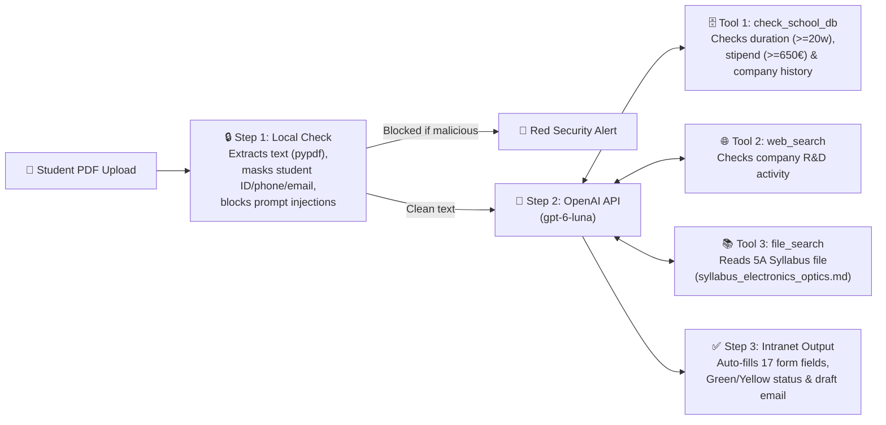
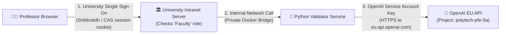

# Polytech Orléans — 5th-Year Internship Validation Prototype

A lightweight Python microservice that helps engineering professors validate 5th-year student internship proposals (PDFs) in seconds.

---

## 1. How It Works



---

## 2. What Is in This Repository

* **`app.py`** — Local web demo (`http://localhost:8765`) for the Faculty Intranet PDF validator (auto-fills 17 form fields, shows Green/Yellow/Red status, and includes the bottom-right **`💬 Ask Internship Agent`** popup widget).
* **`openai_engine.py`** — Core API logic: PDF text extraction (`pypdf`), regex masking of student personal data, prompt-injection check, 2-step OpenAI Responses API tool calls, and 17-field JSON extraction.
* **`agent_demo.py`** — Separate, standalone module powering the bottom-right popup chat widget on the main page using the official **OpenAI Agents SDK** (`from agents import Agent, Runner, function_tool, InputGuardrail`) with our validation API (`validate_internship_offer`) as its single tool.
* **`syllabus_electronics_optics.md`** — The 5th-year Electronics & Optics syllabus rules used by OpenAI `file_search` to distinguish Master-level R&D from technician work.
* **`eval_pipeline.py`** — Automated test suite that grades field accuracy, decision accuracy, and uses `gpt-6-sol` to score syllabus alignment and email tone (1–5) on `sample_pdfs/` and `professor_feedback_evals.json`.
* **`tradeoff_benchmark/`** — Benchmark script comparing local `pypdf` text extraction (`~5.8s`) vs. sending the raw PDF file directly to `gpt-6-luna` multimodal input (`~11.4s`).
* **`Dockerfile` & `docker-compose.yml`** — Container setup to run the service on a university server.

---

## 3. Quickstart (Run Locally)

```bash
# 1. Add your OpenAI API key
cp .env.example .env

# 2. Start the web app on http://localhost:8765
./.venv/bin/python app.py

# 3. Run the automated evaluation suite
./.venv/bin/python eval_pipeline.py
```

---

## 4. 3-Step Integration Guide for University IT (~4 Days)

What is mocked in this prototype vs. what University IT connects for production:

1. **Deploy the Docker Container (0.5 Days):**
   Run `docker compose up -d --build` on an internal university server using a scoped OpenAI Project Service Account Key configured for the EU endpoint (`https://eu.api.openai.com/v1`) with data storage disabled (`store=False`).
2. **Connect `check_school_db` to the School Database (1.5 Days):**
   In `openai_engine.py` (`def check_school_db`), replace the 10-line mock `SCHOOL_DB` dictionary with a read-only SQL `SELECT` query to your existing internship database to look up past internships by company SIRET number.
3. **Connect the Intranet Form (2.0 Days):**
   Point your existing faculty intranet upload button to `POST /api/analyze-pdf` (accessible only to logged-in professors) and map the 17 returned JSON fields to your HTML form inputs.

---

## 5. Authentication: Prototype vs. Production

In this prototype, a single `OPENAI_API_KEY` is loaded from a local `.env` file. In production at the university, authentication is split into **two separate layers** so professors never handle API keys and the OpenAI key is never exposed to the browser:



| Layer | Prototype (Local Demo) | University Production System |
| :--- | :--- | :--- |
| **1. User Authentication (Who can use the tool?)** | Open local web page (`localhost:8765`) with no login screen. | **University Single Sign-On (CAS / RENATER Shibboleth):** Professors log into the intranet as usual. The intranet checks that their university role is **Faculty (`Responsable de Stage`)** before allowing requests to `/api/analyze-pdf`. Students cannot access this endpoint. |
| **2. Internal Service Call (Intranet $\rightarrow$ Python Service)** | Browser calls `app.py` directly. | **Internal Server-to-Server Call:** The Python container runs on an internal university server (not open to the public internet) and only accepts requests from the university intranet backend. |
| **3. OpenAI API Authentication (Python Service $\rightarrow$ OpenAI)** | Personal developer key stored in a local `.env` file. | **OpenAI Project Service Account Key (`sk-svcacct-...`):** Stored in the university server's secret manager (injected as an environment variable at container startup) and tied to a dedicated OpenAI Project (`polytech-pfe-5a`) rather than a person. |
| **4. Key Security & Cost Controls** | Manual key management. | **Scoped Permissions & Hard Budget Cap:** The Service Account key is restricted to `gpt-6-luna` / `gpt-6-sol` on the **EU endpoint (`eu.api.openai.com`)**, with `store=False` (Zero Data Retention) and a hard monthly spend limit (e.g., **€20/month**). |
