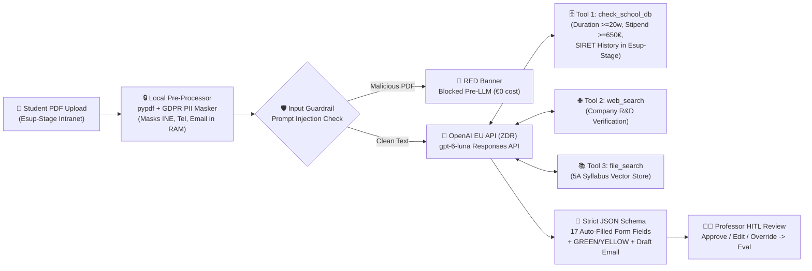

# Polytech Orléans — 5A Engineering Internship Validation Microservice (`Esup-Stage` + OpenAI API)

> **Turnkey IT Handoff Repository for Polytech Orléans DSI (2-Person IT Team) & Data Protection Officer (DPO)**  
> **Stack:** Python 3.11+ • OpenAI Responses API (`gpt-6-luna` Worker + `gpt-6-sol` Eval Judge) • EU Data Residency (`eu.api.openai.com`) • Zero Data Retention (`store: False`)  
> **Estimated University IT Integration Effort:** **~4 Days Total** (Zero self-hosted vector databases or GPU servers to maintain)

---

## 1. Repository Structure (What We Hand Off)

```text
polytech-internship-validator/
├── openai_engine.py               # Core OpenAI Responses API engine (`gpt-6-luna` + 3 Tools + Guardrails + 17-Field Schema)
├── syllabus_electronics_optics.md # 5A Electronics & Optics CTI Master's R&D Rubric (indexed in OpenAI `file_search`)
├── eval_pipeline.py               # 3-Layer OpenAI Cookbook Evaluation Suite (`gpt-6-sol` Model-as-a-Judge)
├── professor_feedback_evals.json  # Closed-loop regression cases logged when a professor overrides an AI flag in the UI
├── app.py                         # Reference Polytech Intranet UI (Tab 1) + Step 2/3 ChatGPT Edu Admin Agent (Tab 2)
├── sample_pdfs/                   # 3 test PDFs: Yellow (Technician PCB), Green (Thales LiDAR + NDA), Red (Prompt Injection)
├── tradeoff_benchmark/            # Empirical benchmark: Local `pypdf` Text vs. `gpt-6-luna` Native Multimodal PDF Input
├── Dockerfile & docker-compose.yml# Stateless container deployment for University VM
├── DEPLOYMENT_PLAYBOOK.md         # Detailed authentication trade-offs & DPO security checklist
└── .env.example                   # Template environment configuration (`eu.api.openai.com`)
```

---

## 2. System Architecture & Data Flow



---

## 3. Simple 3-Step Implementation Guide for Polytech IT (~4 Days Total)

Polytech IT does **not** need to build any AI orchestration or maintain a vector database. To move from this standalone repository into `Esup-Stage` production before the January internship rush, wire these **3 standard hooks**:

### Step 1: Deploy Stateless Container & Scoped OpenAI Service Account (**0.5 Days**)
1. Clone this repository onto an internal Université d'Orléans VM behind your campus Nginx reverse proxy:
   ```bash
   cp .env.example .env
   docker compose up -d --build
   ```
2. In the OpenAI Enterprise/Edu Admin Console, create a dedicated **`polytech-orleans-prod` Project Service Account Key** (`sk-svcacct-...`) pinned to **EU Data Residency (`eu.api.openai.com`)** with a **hard €50/month spend limit** (expected run-rate for all 500 Orléans 5A offers is **~€15/year** at `<€0.03/PDF`).

### Step 2: Connect `check_school_db` to Read-Only `Esup-Stage` MariaDB (**1.5 Days**)
Open [`openai_engine.py`](openai_engine.py) (`def check_school_db`, line 54) and replace the 10-line mock `SCHOOL_DB` dictionary with a parameterized **read-only `SELECT`** against your existing `Esup-Stage` database replica:
```python
# Replace mock dictionary lookup in openai_engine.py with read-only SQL:
cursor.execute(
    "SELECT evaluation_summary FROM esup_stage_history WHERE company_siret = %s LIMIT 5",
    (digits_siret,)
)
```

### Step 3: Wire the `Esup-Stage` Intranet Webhook & CAS SSO Check (**2.0 Days**)
1. When a logged-in professor opens a student's internship submission in `Esup-Stage` (authenticated via your existing **University CAS / Shibboleth SSO**), send the PDF to `POST http://localhost:8765/api/analyze-pdf`.
2. Map the 17 returned JSON keys inside `extracted_form` (`strict: True` guaranteed) to the corresponding HTML form fields, and set a **15-second HTTP timeout** that falls back gracefully to manual entry if the network is unreachable.

---

## 4. DPO & Security Checklist (GDPR + Defense NDA *Huis Clos*)

* **Pre-API PII Redaction (In University RAM):** `run_input_guardrails()` in [`openai_engine.py`](openai_engine.py) masks the student's 11-character national **INE**, phone number, and personal email in memory *before* any payload leaves the university container.
* **EU Data Residency & Zero Data Retention (ZDR):** All requests target `https://eu.api.openai.com/v1` with `store: False` under OpenAI's GDPR Article 28 Data Processing Addendum (zero data stored on disk; zero training on university data).
* **GDPR Article 22 Human-in-the-Loop:** The API never auto-rejects a student. It outputs `GREEN` (Ready for Approval), `YELLOW` (Flagged for Professor Review), or `RED` (Security Alert); a professor always makes the final decision.
* **Defense NDA (*Huis Clos*) Safe:** January internship proposals (*Fiches de stage*) only describe high-level engineering tools (e.g., Zemax, VHDL FPGA) rather than classified Defense parameters, and are processed statelessly under EU ZDR.

---

## 5. Running the Demo, Evaluation Suite & Multimodal Benchmark Locally

```bash
# 1. Start the interactive Intranet + ChatGPT Edu Agent demo server (Port 8765)
./.venv/bin/python app.py

# 2. Run the 3-Layer OpenAI Cookbook Evaluation Suite (`gpt-6-luna` Worker + `gpt-6-sol` Judge)
./.venv/bin/python eval_pipeline.py

# 3. Run the Technical Trade-Off Benchmark (Local `pypdf` vs. `gpt-6-luna` Native Multimodal PDF Input)
./.venv/bin/python tradeoff_benchmark/benchmark_pypdf_vs_multimodal_pdf.py
```
